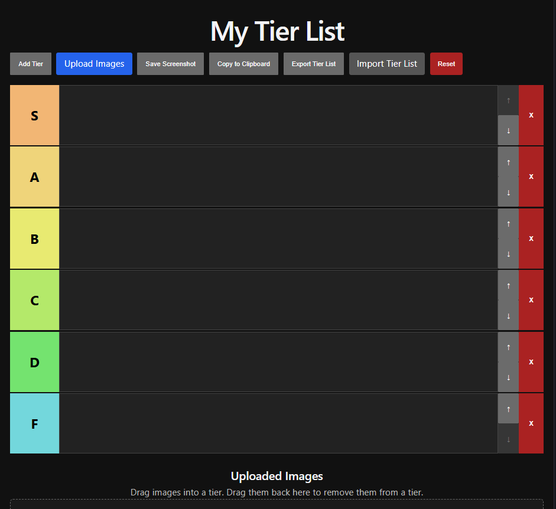

My Tier List
A web application that allows users to create and manage custom tier lists by uploading images and arranging them through drag-and-drop interactions.

Installation
Clone the repository:
git clone https://github.com/KhayyalEB/tier-list-website.git
Open the project folder in VS Code.

Install dependencies:

npm install
Start the development server:
npm run dev
Features
Create custom tiers
Upload images
Drag and drop images between tiers
Save screenshots
Copy tier lists to the clipboard
Import and export tier lists
Reset the tier list